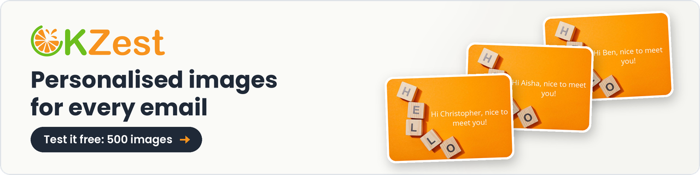

<!-- Banner: 1280x320 from a real OKZest render (Venus) -->

### Hi, I'm Paul 👋

I build **[OKZest](https://okzest.com/?utm_source=github&utm_medium=profile&utm_campaign=techboy_readme&utm_content=intro)**: personalised images for email, where every subscriber sees their own name, offer or live data in the picture.

By day I'm Head of SAP Technical Services at Birchman.

---

### 🚀 What OKZest does

- **Personalised email images:** offer banners, VIP cards, basket reminders and event tickets, made for each reader.
- **Live data:** figures in the image update each time it's opened, so they're always current.
- **Works in your ESP:** drop one image URL into your email platform's template.
- **Built for agencies:** one template, every client campaign.

---

### 🛠 Other things I'm building

| Project | What it is |
|---|---|
| [OKZest](https://okzest.com/?utm_source=github&utm_medium=profile&utm_campaign=techboy_readme&utm_content=table) | Personalised and live images for email marketing |
| [saptls](https://saptls.com) | SSL/TLS certificates and install guides for SAP systems |
| [SelfCrypto](https://selfcrypto.com/) | Plain-English crypto guides for UK beginners |

---

### 📫 Find me

[X @TechboyUK](https://x.com/TechboyUK) · [OKZest](https://okzest.com/?utm_source=github&utm_medium=profile&utm_campaign=techboy_readme&utm_content=footer)
